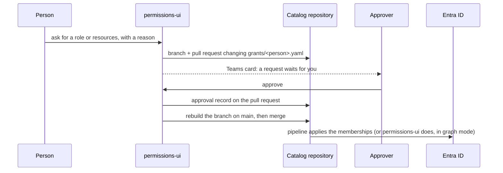

# permissions-ui

See and manage who has access to what. People ask for access in the browser, the right person
approves, and every grant is a pull request in your catalog repository. Merging is the grant;
Entra ID enforces it.

- **One catalog for everything that can be granted**: Entra ID groups, GitHub teams, and
  systems someone sets up by hand. Each entry says what it is for, who owns it, how risky it
  is and who approves it, so no group is a mystery any more.
- **Roles bundle what a job needs.** A team lead onboards someone with one request: everything
  the team gives a new member, approved by the asking itself.
- **Approvals that hold up.** Each resource needs its own approver; privileged access needs two;
  nobody approves their own request; access the catalog keeps apart cannot be combined.
- **Git is the record.** Every request is a pull request, every approval a comment on it, and
  the history of `grants/` says who had what, when and why. The server stores nothing.
- **At a glance**: who holds privileged access, access nobody granted (in the group, not in the
  catalog), grants not applied yet, groups no resource describes, and what expires soon.
- **Expiry and removal**: grants can run out and are removed by a daily job; removing access
  needs no approval and happens at once.

## How it works



People sign in with Entra ID. The app reads the directory (who exists, who is in which group) as
itself or, in the `delegated` directory mode, as the signed-in person, and writes only to the
catalog repository, through a GitHub App installed there alone.
Changing the groups is left to the pipeline that applies the catalog, with the reference
Terraform module in [`terraform/entra-grants`](terraform/entra-grants), unless you choose the
`graph` mode, where the app changes them itself.

## The catalog

A folder of YAML in a repository you own (see [`examples/catalog`](examples/catalog)):

```
resources/*.yaml   what access is granted to
roles/*.yaml       bundles of resources
teams/*.yaml       leads, and the roles a new member gets
grants/<name>.yaml one file per person, written by permissions-ui
```

People are named by their user principal name in your directory, as Graph shows it. For a guest
that is the `…#EXT#@…` one, not the address they sign in with. A grants file is named for the
person part of it (`grants/jane.doe.yaml` for `jane.doe@example.com`, and for a guest the name
their home tenant gives them), or the whole UPN when someone else has that name already. Its
`name:` is the person's display name up to their surname, so a suffix such as ` - Contoso` is
dropped; permissions-ui writes it each time it changes the file.

```yaml
# resources/kubernetes.yaml
- id: k8s-prd-cluster-admin
  name: Kubernetes prd, cluster-admin
  description: Everything on the prd cluster. For incidents and platform work only.
  owner: platform                  # a team; its leads approve unless approvers says otherwise
  kind: entra-group                # entra-group, github-team or manual
  target: k8s-prd-cluster-admin    # the group's display name or object id
  tier: privileged                 # standard, elevated or privileged (two approvals)
  max_days: 30                     # longest a grant may run
  incompatible: [prd-release-approver]
```

```yaml
# roles/roles.yaml
- id: payments-developer
  name: Payments developer
  description: Everything a developer on the payments team needs on day one.
  resources: [k8s-acc-payments-write, k8s-prd-payments-read, grafana-viewer, vpn]
  approvers: [team:payments]       # team:<id>, group:<entra group>, user:<upn>
  max_days: 365
```

```yaml
# teams/teams.yaml
- id: payments
  name: Payments
  leads: [katherine.johnson@example.com]
  roles: [payments-developer]
```

A `manual` resource names its `fulfillers` and `instructions`; once its request is granted it
appears under **Tasks** for them until they mark it done.

Check the catalog in its own repository's CI, so a hand edit that breaks it never merges:

```bash
docker run --rm -v "$PWD/access:/catalog:ro" ghcr.io/magmamoose/permissions-ui:<tag> check /catalog
```

## Who does what

| | Sees | Can |
|---|---|---|
| Everyone | the catalog, their own access, requests that involve them | ask for access, remove their own |
| Team leads | everyone's access and every request | ask for someone else (it counts as their approval), onboard, remove access |
| App role `Admin` | the same | also remove anyone's access, decline any request |
| App role `Auditor` | the same | nothing more: read-only |
| Approvers | requests that wait for them | approve or decline |
| Fulfillers | tasks for their manual resources | mark them done |

## Rules

- Each resource in a request needs approvals from its role's approvers when its role names some,
  else its own, else the leads of the team that owns it.
- `privileged` resources need two approvals unless `approvals` says otherwise.
- Nobody approves a request they made or one that gives them access. A lead asking for someone
  else counts as one approval, so an onboarding is one click; privileged access still waits for a
  second person.
- Resources listed as `incompatible` with each other are never granted to one person together.
- A grant runs at most the shortest `max_days` among what it gives.
- Removing access needs no approval and merges at once. Expired grants are removed by the daily
  `expire` job.
- Only records this app writes and signs count. A comment typed on the pull request approves
  nothing, and neither does one another tool writes as the same GitHub App.

## Setting up

### 1. The catalog repository

Create a private repository with the folders above (start from `examples/catalog`), and add the
`check` step to its CI. If `main` requires reviews, allow the GitHub App to bypass them or to
satisfy them with its review, or set `config.merge: manual` and merge by hand.

### 2. The Entra ID app registration

- Platform **Web**, redirect URI `https://<host>/auth/callback`.
- App roles `Admin` and `Auditor` (allowed member types: users), assigned to who needs them.
- Microsoft Graph permissions to read the directory, for one of two modes (`config.directory`):
  - `app`, the default: **application** permissions `User.Read.All` and `GroupMember.Read.All`,
    and the app reads as itself. Admin consent to Microsoft Graph application permissions takes
    a Privileged Role Administrator (or a Global Administrator).
  - `delegated`: **delegated** permissions `openid`, `profile`, `offline_access`, `User.Read.All`
    and `GroupMember.Read.All`, with tenant-wide admin consent, which a Cloud Application
    Administrator or Application Administrator can grant. The app reads as the signed-in person
    and sees what they may see: by default a member reads every user and group, a guest less,
    and a tenant can stop members reading other users. The person's refresh token rides in their
    sealed session cookie. The expiry job reads no Graph, so it needs nobody signed in.
- For the `graph` fulfilment mode, the `app` mode with `GroupMember.ReadWrite.All` instead, or
  better, Groups Administrator scoped to an administrative unit that holds only the groups in the
  catalog. It does not combine with `delegated`: changing groups needs the app's own permission.
- On Kubernetes, a federated credential for the service account: issuer, your cluster's
  service-account issuer; subject, `system:serviceaccount:<namespace>:<service account>`;
  audience, `api://AzureADTokenExchange`. Or a client secret where there is no workload identity.

### 3. The GitHub App

Repository permissions **Contents**, **Pull requests** and **Issues**: read and write; **Metadata**:
read. Install it on the catalog repository only, and keep its private key in a Secret. The app asks
GitHub for a token for the catalog repository with exactly these permissions, so an App that other
tools share lends it nothing more; if the installation lacks one, the app says which.

### 4. Applying grants

Run [`terraform/entra-grants`](terraform/entra-grants) from the catalog repository's pipeline on
every merge. Or set `config.fulfilment: graph` to let permissions-ui change the groups itself
(in the `app` directory mode only).

### 5. Install

```bash
helm install permissions-ui oci://ghcr.io/magmamoose/charts/permissions-ui \
  --namespace access --create-namespace \
  --set azure.tenantId=<tenant> --set azure.clientId=<client id> \
  --set config.publicOrigin=https://access.example.com \
  --set catalog.repository=<owner>/<catalog repository> --set catalog.path=access \
  --set catalog.app.id=<app id> --set catalog.app.privateKey.existingSecret=permissions-ui-github \
  --set ingress.enabled=true
```

The chart runs two replicas behind a PodDisruptionBudget and the daily expiry CronJob; every value
is described in [`charts/permissions-ui/values.yaml`](charts/permissions-ui/values.yaml).

## Configuration

| Variable | |
|---|---|
| `AZURE_TENANT_ID`, `AZURE_CLIENT_ID` | the app registration |
| `AZURE_FEDERATED_TOKEN_FILE` or `AZURE_CLIENT_SECRET[_FILE]` | its credential |
| `AZURE_AUTHORITY_HOST` | a sovereign cloud's login host; default `https://login.microsoftonline.com` |
| `PERMISSIONS_UI_PUBLIC_ORIGIN` | where people open it, `https://host` |
| `PERMISSIONS_UI_SESSION_KEY[_FILE]` | at least 32 characters, the same on every replica |
| `PERMISSIONS_UI_RECORD_KEY[_FILE]` | signs the app's records on pull requests: at least 32 characters, one key per line, the first signs (see [Security](#security)) |
| `PERMISSIONS_UI_SESSION_HOURS` | 1 to 24, default 8 |
| `PERMISSIONS_UI_GITHUB_REPO`, `_BRANCH`, `PERMISSIONS_UI_CATALOG_PATH` | the catalog repository, its branch (`main`) and folder |
| `PERMISSIONS_UI_GITHUB_APP_ID` + `PERMISSIONS_UI_GITHUB_APP_PRIVATE_KEY[_FILE]`, or `PERMISSIONS_UI_GITHUB_TOKEN[_FILE]` | how it writes there |
| `PERMISSIONS_UI_GITHUB_API` | GitHub Enterprise Server's API URL; default `https://api.github.com` |
| `PERMISSIONS_UI_GITHUB_BOT` | whose comments count as approval records; found out by itself |
| `PERMISSIONS_UI_CATALOG_DIR` | instead of a repository: a local catalog, read-only |
| `PERMISSIONS_UI_FULFILMENT` | `pull-request` (default) or `graph` |
| `PERMISSIONS_UI_DIRECTORY` | `app` (default): Microsoft Graph read as the app; `delegated`: as the signed-in person, not with `graph` fulfilment |
| `PERMISSIONS_UI_MERGE` | `auto` (default) or `manual` |
| `PERMISSIONS_UI_GROUP_PREFIXES` | comma-separated group name prefixes to check for undocumented groups |
| `PERMISSIONS_UI_ADMIN_ROLE`, `PERMISSIONS_UI_AUDITOR_ROLE` | app role values; default `Admin`, `Auditor` |
| `PERMISSIONS_UI_TEAMS_WEBHOOK[_FILE]` | a Teams workflow webhook for notifications |
| `PERMISSIONS_UI_BRAND_ACCENT`, `_ACCENT_TEXT`, `_ACCENT_DARK`, `_ACCENT_TEXT_DARK` | your colours as `#rrggbb` |

`python -m permissions_ui [serve | check <dir> | expire]`: the server (default), the catalog check,
and the expiry run.

## Security

- **Backend for frontend.** The browser holds no token it can read: the session is an AES-GCM
  sealed, `__Host-`, `HttpOnly`, `Secure`, `SameSite=Strict` cookie, and every write also needs a
  CSRF token and this origin. No inline script or style, under a strict Content Security Policy.
  In the `delegated` directory mode the sealed cookie carries the person's refresh token, never
  an access token; redeeming it takes the app's own credential, and the Graph tokens it is
  redeemed for stay in each replica's memory.
- **The app's write access is the catalog repository.** Its GitHub App token is asked for that
  repository alone, with contents, pull requests and issues write and metadata read, even when the
  App is installed more widely or shared with other tools. It reads the directory, as itself or as
  the signed-in person; it writes to it only in the `graph` mode.
- **Approvals are checked by the server** against the catalog and the directory before the app
  records them.
- **Only the app's own signed records count.** The request in the pull request body and every
  approval, decline and done note carry an HMAC-SHA256 under `PERMISSIONS_UI_RECORD_KEY` over the
  pull request's number. A record that is unsigned, changed, copied from another pull request or
  written by another login counts for nothing. So another tool commenting as the same GitHub App
  approves nothing, and a request whose record is edited on GitHub stops being a request. The
  summary above the record is for people; the portal shows and acts on the record.
- **Records from before the key, and rotation.** Records written before the key existed carry no
  signature: requests opened before the upgrade drop out of the portal (close those still open and
  ask again), while the access they granted stays in the grants files. The key file holds one key
  per line; the first signs and every one verifies. To rotate, put the new key on the first line
  and keep the old one below it while its requests should still show. Remove a key that may have
  leaked: what it signed stops counting. The chart creates the key once and keeps it through
  upgrades and uninstalls.
- **Every change is reviewable**: a request, its approvals and its merge are a pull request, so
  the repository's history is the audit trail, and its branch rules still apply.

## Development

```bash
uv sync
uv run pytest
uv run python -m permissions_ui check examples/catalog
cd frontend && npm install && npm run dev   # the UI on 5173, the API proxied to 8080
```

## Licence

Apache-2.0, see [LICENSE](LICENSE).
